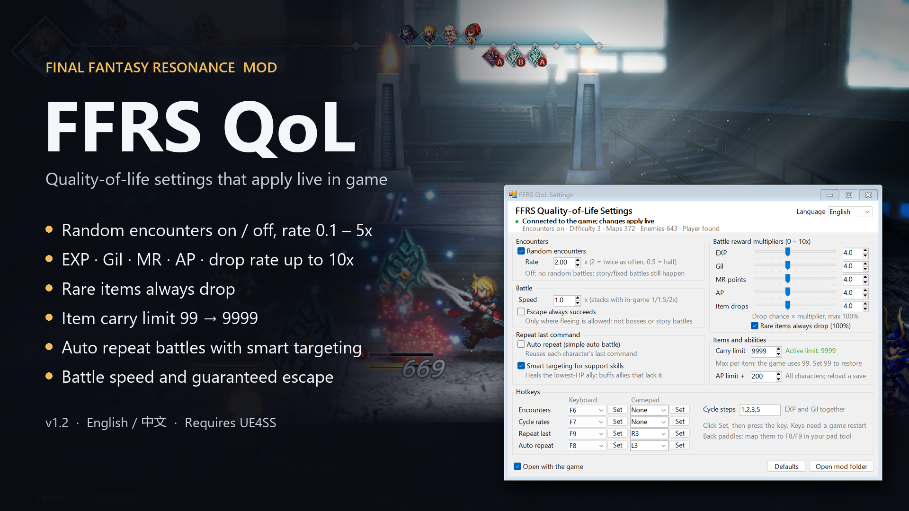

# FFRS QoL

Quality-of-life mod for **FINAL FANTASY RESONANCE** (Steam PC), built on [UE4SS](https://github.com/UE4SS-RE/RE-UE4SS).
It comes with a settings window, and changes apply in game within about a second.



[中文说明](#中文说明)

## Features

**Field**
- Turn random encounters on or off (story and fixed battles still happen)
- Encounter rate from 0.1x to 5x
- Chest and item markers on the minimap and world map (looted ones are hidden), hidden paths shown on the map,
  and exits marked when the area behind them still has loot, based on
  [Item and Chest Markers](https://www.nexusmods.com/finalfantasyresonance/mods/25) by ZArkadia

**Battle rewards**
- EXP, Gil, MR point and AP multipliers (0–10x)
- Item drop chance multiplier, plus an option to make rare items always drop

**Battle**
- Battle speed multiplier (stacks with the game's own 1 / 1.5 / 2x)
- Escape always succeeds (not for bosses or story battles)
- Repeat last command / auto repeat: a simple auto battle that reuses each character's last command (the PC version has no auto battle)
  - Whole W turns (W-Arm and similar) are repeated as one, with MP checked at the real cost; if MP runs short it falls back to the character's last single action
  - Attacks always go to a living enemy and support skills to allies, even if the recorded target was a party member
  - Characters who are confused, charmed or berserk are left to you, and what they do is not recorded
- Smart targeting for support skills: heals go to the lowest-HP ally, buffs go to allies that don't have them yet
- Limit Burst gain multiplier (0–10x) and an option to keep each character's LB gauge between battles
- Libra scans all enemies: Libra and Mechamog Scan (and items that cast them) hit the whole enemy side, using the game's own scan, so the bestiary and weaknesses update as usual (on by default; only the skill table in memory changes)
- Auto Libra: every enemy is scanned as the battle starts, weaknesses included, even on the first meeting (off by default; like a real Libra it is kept in your save)
- On-screen notices: an "Auto repeat ON" badge in battle and short messages for hotkeys

**Items and abilities**
- Add items: search any consumable, material or equipment in the settings window and add it to your inventory (key items are left out)
- Ability AP limit bonus for every character (applies after loading a save)
- More ability slots: 8 to 12 per character (applies after loading a save). The equipment screen shrinks its rows so every slot fits on the panel, which also fixes the bottom row other mods' extra accessory slots push out of view. More slots need more AP, so raise the AP limit too. Lowering the setting keeps abilities already in the extra slots until you unequip them
- Item carry limit up to 9999 (`ItemLimit.ps1`, see [Antivirus note](#antivirus-note)); shops let you buy past 99 too

Defaults: encounters on, EXP 2x, Gil 2x, everything else vanilla.

## Download

Get the zips from [Releases](https://github.com/LeiGaoRobot/FFRS-QoL/releases):

| File | What it is |
|---|---|
| `FFRS_QoL_v*_all-in-one_ZH.zip` | Mod + UE4SS + item limit, ready to use. Readme in Chinese; the settings window is English or Chinese. |
| `FFRS_QoL_v*_mod-only_EN.zip` | Mod only, English readme. Install UE4SS yourself first. |
| `FFRS_QoL_v*_ItemLimit-addon.zip` | Adds the item carry limit to the mod-only package. |

## Install

1. **UE4SS** (skip with the all-in-one zip): download `UE4SS_v3.0.1-....zip` (not `zDEV`) from the
   [UE4SS experimental release](https://github.com/UE4SS-RE/RE-UE4SS/releases/tag/experimental-latest)
   and extract it into `FFRS\Binaries\Win64` (next to `FFRS-Win64-Shipping.exe`). Tested with build `1181-g83330635`.
2. **This mod**: in Steam, right-click the game > Manage > Browse local files, then drag the `FFRS` folder
   from the zip into that folder and choose Replace.
3. Launch the game. The settings window opens automatically.

The mod ships its own `UE4SS-settings.ini` (engine version 5.6, console off) and an `enabled.txt`, so `mods.txt` needs no edits.
To reopen the settings window, run `FFRS_QoL_Settings.bat`, or right-click `Settings.ps1` > Run with PowerShell.

### In-game settings with MogHub (optional)

If [MogHub](https://www.nexusmods.com/finalfantasyresonance/mods/110) is installed, FFRS QoL also shows up in the game's
own **Mods** menu (title screen or main menu > Mods > FFRS QoL), usable with a controller. It edits the same `config.ini`
as the settings window, so a change in either place applies at once and shows up in the other. Nothing extra to install:
the page is `moghub.lua` in the mod folder, and without MogHub it is simply not used.

The menu has the field, reward, battle (including the two Libra options), repeat, AP limit, ability slots and carry limit settings. Hotkeys and pad buttons, the multiplier
cycle steps and Add item stay in the settings window, which the menu can open. Switching the FFRS QoL page off in MogHub
only hides the page; to turn the mod off, remove its folder.

### Hotkeys (defaults, rebindable in the settings window)

| Key | Action |
|---|---|
| F6 | Toggle encounters |
| F7 | Cycle EXP/Gil multiplier (1 / 2 / 3 / 5x) |
| F8 / Gamepad L3 | Toggle auto repeat |
| F9 / Gamepad R3 | Repeat last command |

### Uninstall

Delete `FFRS\Binaries\Win64\ue4ss\Mods\FFRS_QoL` and the `FFRS\Content\Paks\~mods\zzz_TreasureMinimap_P.*` and `zzz_RevealHiddenAreas_P.*` files (map markers).
To remove UE4SS too, delete `FFRS\Binaries\Win64\dwmapi.dll` and the `ue4ss` folder.
Saves are not touched. If you raised the AP limit, set it back to 0 and load your save once first. Extra ability slots stay in a save that was saved with them; unequip the abilities in them first if you want the game back to exactly 8.

## Antivirus note

`ItemLimit.ps1` raises the 99 item cap. The game hardcodes 99 in its code, so the script opens
`FFRS-Win64-Shipping.exe`, checks 14 known spots for the original bytes, and rewrites only those spots in memory.
It also raises the two 99s in the shop's buy dialog (in the loaded Blueprint's bytecode, checked the same way).
It never changes files on disk and skips anything that doesn't match (for example after a game update).
Some antivirus engines (mostly BitDefender-based) flag any script that writes another program's memory, so this
file can get a false positive. Everything else works without it.

## Repository layout

```
mod/FFRS/Content/Paks/~mods/
  zzz_TreasureMinimap_P.*     map marker pak (by ZArkadia)
  zzz_RevealHiddenAreas_P.*   shows hidden paths on the map (by ZArkadia)
mod/FFRS/Binaries/Win64/ue4ss/
  UE4SS-settings.ini          UE4SS config for this game
  Mods/FFRS_QoL/
    Scripts/main.lua          the mod (UE4SS Lua)
    Scripts/markers.lua       map markers (based on ZArkadia's Item and Chest Markers)
    Scripts/field_items.lua   shining-spot list for the map markers (by ZArkadia)
    Scripts/chest_items.lua   chest list for the map markers (by ZArkadia)
    Settings.ps1              settings window (WinForms), edits config.ini
    ItemLimit.ps1             item carry limit patcher (optional)
    FFRS_QoL_Settings.bat     opens the settings window
    moghub.lua, moghub.ini    settings page in MogHub's in-game Mods menu (used only when MogHub is installed)
    lang/*.ini                Chinese texts for that page
    config.ini                default settings
    enabled.txt               makes UE4SS load the mod
```

## Credits

- [UE4SS](https://github.com/UE4SS-RE/RE-UE4SS) team (MIT license). The all-in-one zip includes the UE4SS binaries from the official release and their license.
- ZArkadia for [Item and Chest Markers (Including World Map)](https://www.nexusmods.com/finalfantasyresonance/mods/25):
  the map marker paks, the shining-spot and chest lists and the marker logic that `markers.lua` is based on, used and modified with
  credit as that mod's permissions allow. Those files are not covered by this repository's MIT license.

## License

[MIT](LICENSE)

---

## 中文说明

FINAL FANTASY RESONANCE（Steam PC 版）便利功能 MOD，基于 UE4SS，带中英文图形设置窗口，改完约 1 秒内生效。

**功能**：开关随机遇敌 / 遇敌频率（0.1–5 倍）、宝箱和道具地图标记、经验 / 金钱 / MR / AP 倍率、掉落率倍率和稀有物品必掉、
战斗加速、逃跑必定成功、重复上次指令 / 自动重复（简易自动战斗，支持 W 臂腕，混乱时交给玩家，攻击只打敌人）、辅助技能智能选目标、
LB 充能倍率 / LB 槽跨战斗保留、Libra 扫描全体敌人（默认开）/ 自动 Libra（默认关，会记入存档）、添加物品、能力 AP 上限加成、能力栏扩展（每人 8–12 格，装备画面会自动缩小行高放得下）、物品持有上限最高 9999（商店也能买超过 99）。

地图标记基于 ZArkadia 的 [Item and Chest Markers](https://www.nexusmods.com/finalfantasyresonance/mods/25)，经其许可规定署名使用。

**下载**：在 [Releases](https://github.com/LeiGaoRobot/FFRS-QoL/releases) 下载 `FFRS_QoL_v*_all-in-one_ZH.zip`（整合包，自带 UE4SS，解压即用）。

**安装**：Steam 里右键游戏 → 管理 → 浏览本地文件，把压缩包里的 `FFRS` 文件夹拖进去，选择替换，然后启动游戏。

**游戏内设置（可选）**：装了 [MogHub](https://www.nexusmods.com/finalfantasyresonance/mods/110) 的话，标题画面或主菜单 → Mods → FFRS QoL
里也能改设置，支持手柄。它和设置窗口改的是同一个 `config.ini`，两边改动都会立即生效、互相同步；不用另外安装。
快捷键绑定、倍率循环档位和添加物品仍在设置窗口里（菜单里可以一键打开）。

**杀毒软件提示**：`ItemLimit.ps1`（物品上限）只修改运行中游戏内存里的 99 上限，不改动硬盘上的游戏文件，
但部分杀毒软件会误报。不想用可以删掉它，其他功能照常。
